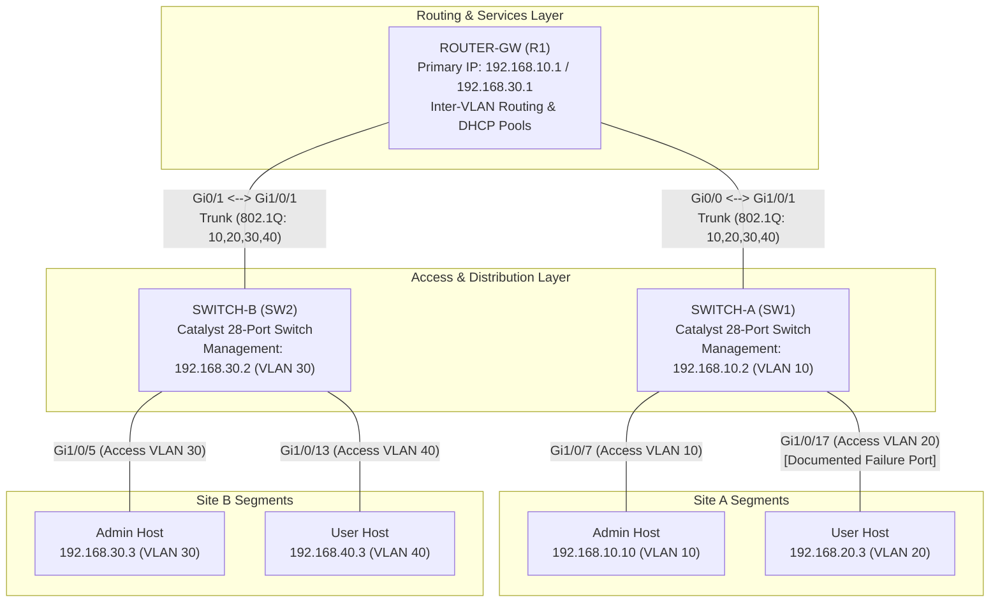
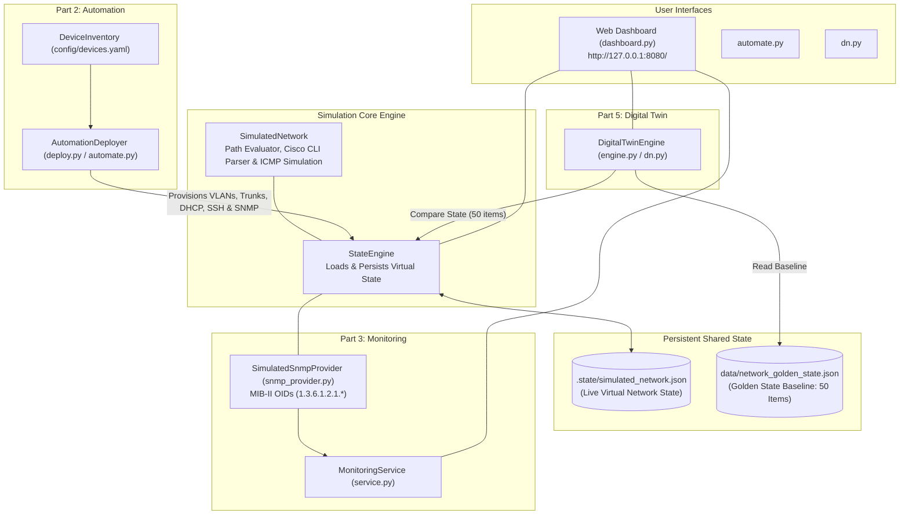

# Network Digital Twin & Automation System

[](https://www.python.org/downloads/)
[](#software-architecture)
[](#part-5--network-digital-twin)
[](#test-suite--verification-results)

> **Simulation Disclaimer:**  
> This project is a complete, self-contained **software reconstruction** based on a 20-page Cisco laboratory technical report (*Rapport de Travaux Pratiques: Infrastructure Réseau, Automatisation, Supervision & Jumeaux Numériques*). All router/switch network entities, 802.1Q trunks, subinterfaces, SSH CLI sessions, and SNMP telemetry are simulated in pure Python. The system runs **100% offline** without requiring Cisco hardware, GNS3, or Cisco Packet Tracer, and binds no external network listeners.

---

## 1. Project Overview & Objectives

In enterprise network engineering, detecting configuration drift and physical link degradation before user impact is critical. This project implements a modular networking framework that demonstrates:

1. **Hierarchical Network Topology & Inter-VLAN Routing:** Modeling Cisco routers and switches across four segmented VLANs (management and user traffic).
2. **Network Automation:** Netmiko-compatible automated provisioning of VLAN databases, 802.1Q dot1Q trunks, access ports, DHCP pools, and service credentials.
3. **SNMP Telemetry & Monitoring:** MIB-II operational polling (`sysUpTime`, `ifDescr`, `ifOperStatus`) with deterministic interface indexing and automatic reachability detection.
4. **Structured Troubleshooting & Diagnostic CLI:** Simulation of administrative link failures (`shutdown` on `SWITCH-A Gi1/0/17`) and diagnostic inspection matching Cisco IOS commands (`show interfaces`, `show ip interface brief`, `show interfaces status`).
5. **Network Digital Twin Prototype:** A Golden State comparison engine that quantifies infrastructure health via an integrity score ($100\% \to 98\% \to 100\%$) and generates actionable mismatch alerts upon deviation.
6. **Local Web Dashboard:** A real-time local web interface (with 10-second automatic refresh) providing telemetry, diagnostic consoles, and one-click fault injection/recovery controls.

---

## 2. Network Topology & Addressing Plan

### Physical & Logical Topology



### IP Addressing & VLAN Segmentation

| VLAN ID | Role / Designation | Subnet | Gateway (R1 Subinterface) | Switch SVI | Connected Endpoints |
|---|---|---|---|---|---|
| **VLAN 10** | Management SW-A | `192.168.10.0/24` | `192.168.10.1` (`Gi0/0.10`) | `192.168.10.2` (SW-A) | Admin PC (`192.168.10.10`) on SW-A `Gi1/0/7` |
| **VLAN 20** | Users Segment A | `192.168.20.0/24` | `192.168.20.1` (`Gi0/0.20`) | — | User PC (`192.168.20.3`) on SW-A `Gi1/0/17` |
| **VLAN 30** | Management SW-B & Router | `192.168.30.0/24` | `192.168.30.1` (`Gi0/1.30`) | `192.168.30.2` (SW-B) | Admin PC (`192.168.30.3`) on SW-B `Gi1/0/5` |
| **VLAN 40** | Users Segment B | `192.168.40.0/24` | `192.168.40.1` (`Gi0/1.40`) | — | User PC (`192.168.40.3`) on SW-B `Gi1/0/13` |

---

## 3. Software Architecture

All components share a single, thread-safe persistence layer (`.state/simulated_network.json`). Changes introduced by any tool (CLI, automation, or dashboard) are immediately visible to all other modules on their next read.



---

## 4. Directory Structure

```text
network-dt/
├── .state/
│   └── simulated_network.json       # Live shared network state file
├── config/
│   ├── devices.yaml                 # Netmiko device inventory (matching Figure 6)
│   └── topology.yaml                # Declarative network topology specification
├── data/
│   └── network_golden_state.json    # Digital Twin Golden State reference model
├── docs/
│   └── IMPLEMENTATION_PLAN.md       # Architectural specification & requirements
├── src/
│   └── network_dt/
│       ├── __init__.py
│       ├── core/
│       │   ├── __init__.py
│       │   ├── models.py            # Device, Interface, VLAN, DHCP data models
│       │   └── state_engine.py      # Shared state persistence and alias resolution
│       ├── automation/
│       │   ├── __init__.py
│       │   ├── deploy.py            # Automated deployment & verification engine
│       │   └── templates.py         # Cisco IOS CLI command generators
│       ├── monitoring/
│       │   ├── __init__.py
│       │   ├── dashboard.py         # Zero-dependency local web dashboard server
│       │   ├── service.py           # Monitoring service, event logs, change detection
│       │   └── snmp_provider.py     # Pure-Python MIB-II SNMP provider
│       ├── simulation/
│       │   ├── __init__.py
│       │   └── sim_network.py       # Pure-software ping, traceroute & Cisco IOS CLI
│       └── twin/
│           ├── __init__.py
│           ├── engine.py            # Digital Twin calibration & 50-port scoring
│           └── models.py            # Deviation alerts and check result models
├── tests/
│   ├── __init__.py
│   ├── test_automation.py           # Netmiko automation & verification tests (6 tests)
│   ├── test_dashboard.py            # Local dashboard HTTP & REST API integration tests (3 tests)
│   ├── test_digital_twin.py         # Digital Twin calibration & 100%->98%->100% tests (6 tests)
│   ├── test_monitoring.py           # SNMP provider & telemetry tests (8 tests)
│   └── test_simulation.py           # Network simulation & path routing tests (9 tests)
├── .gitignore
├── automate.py                      # Network automation CLI entry point
├── dashboard.py                     # Local web dashboard launcher
├── dn.py                            # Digital Twin CLI entry point (Figures 16 & 17)
├── pyproject.toml                   # Project packaging specification
├── README.md                        # Documentation
└── requirements.txt                 # Minimal dependencies (PyYAML)
```

---

## 5. Technical Workflows

### Part 2 — Network Automation
- **Inventory (`config/devices.yaml`):** Loads connection parameters for `SW1`, `R1`, and `SW2` using the documented credentials (`admin` / `password123`) and `cisco_ios` device type.
- **Automated Provisioning:** Generates Cisco IOS command transcripts and applies changes to the shared model:
  - SSH v2 activation with RSA 1024-bit modulus keys.
  - SNMP agent activation (`public` read-only community, location `Lab`, contact `Admin`).
  - Switch VLANs (10, 20, 30, 40) and access-port assignments.
  - 802.1Q dot1Q trunking on `Gi1/0/1`.
  - Router subinterfaces (`Gi0/0.10`, `Gi0/0.20`, `Gi0/1.30`, `Gi0/1.40`) with IP gateways.
  - Central DHCP server pools with exclusions and Google DNS (`8.8.8.8`).
- **Automated Verification:** Runs a 20-point verification check validating configurations, service reachability, and inter-VLAN traceroute hops.

### Part 3 — SNMP Telemetry & Monitoring
- **Standard MIB OIDs:**
  - `OID_SYS_NAME` (`1.3.6.1.2.1.1.5.0`): Device hostname.
  - `OID_SYS_UPTIME` (`1.3.6.1.2.1.1.3.0`): Device sysUpTime in hundredths of a second.
  - `OID_IF_DESCR` (`1.3.6.1.2.1.2.2.1.2`): Interface description subtree.
  - `OID_IF_STATUS` (`1.3.6.1.2.1.2.2.1.8`): Operational status (`1 = UP`, `2 = DOWN`).
- **Telemetry Processing:** Implements `snmp_walk_interfaces()` matching Figure 11 of the report, mapping code `1` $\to$ `"UP (OK)"` and `2` $\to$ `"DOWN (FAIL)"`.
- **Change Detection:** Automatically logs structured events (`INTERFACE_DOWN`, `INTERFACE_UP`, `DEVICE_UNREACHABLE`) when interface operational status transitions.

### Part 4 — Troubleshooting & Recovery
- **Documented Failure Scenario:** Administrative shutdown of `SWITCH-A GigabitEthernet1/0/17` (carrying host `192.168.20.3`).
- **Cisco IOS Diagnostics:** Replicates exact CLI diagnostic output:
  - `show interfaces GigabitEthernet1/0/17` $\to$ `is administratively down, line protocol is down`
  - `show interfaces status` $\to$ `status: disabled`
  - `show ip interface brief` $\to$ `status: administratively down, protocol: down`
- **Remediation:** Issuing `no shutdown` restores the interface to operational state `UP (OK)` and re-establishes inter-VLAN ICMP connectivity.

### Part 5 — Network Digital Twin
- **Baseline Calibration (`python dn.py calibrate`):** Captures the healthy reference state across all 3 devices and saves it to `data/network_golden_state.json`. Safe calibration guards prevent accidental overwriting unless `--force` is specified.
- **Scoring Rule:** The canonical prototype model monitors $N_{\text{total}} = 50$ operational interfaces across the infrastructure:
  - 2 Router physical uplinks (`Gi0/0`, `Gi0/1`)
  - 24 Gigabit ports on Switch A (`Gi1/0/1` through `Gi1/0/24`)
  - 24 Gigabit ports on Switch B (`Gi1/0/1` through `Gi1/0/24`)
  
  $$\text{Integrity Score} = \operatorname{round}\left( \frac{N_{\text{matching}}}{N_{\text{total}}} \times 100 \right)$$

  - **Baseline:** $50 / 50 \to \mathbf{100\%}$ (`SYSTEM HEALTHY - MATCHES TWIN MODEL`)
  - **Fault Injected:** $49 / 50 \to \mathbf{98\%}$ (`WARNING - DEVIATION DETECTED`)
  - **Recovery:** $50 / 50 \to \mathbf{100\%}$ (`SYSTEM HEALTHY - MATCHES TWIN MODEL`)
- **Deviation Alerts:** Explicitly flags the affected equipment and interface:
  ```text
  --- DETECTED FAULTS (Deviation from Model) ---
  > [SWITCH-A] STATE MISMATCH: GigabitEthernet1/0/17 is DOWN (Model expects UP)
  ```

---

## 6. Installation & Execution

### Prerequisites
- Python 3.10 or higher.
- Standard operating systems (Windows, Linux, macOS).

### Quickstart Setup

```bash
# 1. Clone repository
git clone <repository-url>
cd network-dt

# 2. (Optional) Create virtual environment
python -m venv .venv
# On Windows:
.venv\Scripts\activate
# On Linux/macOS:
source .venv/bin/activate

# 3. Install minimal dependencies
pip install -r requirements.txt
```

### Execution Commands

| Component | Command | Description |
|---|---|---|
| **Digital Twin Check** | `python dn.py` | Runs live integrity check against Golden State. |
| **Digital Twin Calibrate** | `python dn.py calibrate --force` | Captures current state and writes Golden State JSON. |
| **Automation Deploy & Verify**| `python automate.py` | Runs automated Netmiko deployment and 20-point verification. |
| **Automation Verify Only** | `python automate.py --verify-only`| Evaluates current configuration against verification rules. |
| **Web Dashboard** | `python dashboard.py --port 8080` | Starts the local web telemetry dashboard at `http://127.0.0.1:8080/`. |
| **Run Unit Tests** | `python -m unittest discover tests` | Runs all 32 automated unit and integration tests. |

---

## 7. Complete Failure & Recovery Demonstration

The failure and recovery cycle documented in Section 4 and 5 of the report can be reproduced in under one minute:

```powershell
# Step 1: Confirm normal state (100% integrity)
python dn.py
# Output: [ integrity: 100% ] SYSTEM HEALTHY - MATCHES TWIN MODEL

# Step 2: Inject failure (Administrative shutdown of SW1 Gi1/0/17)
python -c "from src.network_dt.core.state_engine import StateEngine; s = StateEngine(); s.set_interface_status('SWITCH-A', 'GigabitEthernet1/0/17', 'DOWN')"

# Step 3: Run Digital Twin check (Detects deviation, reports 98%)
python dn.py
# Output:
# [ integrity: 98% ] WARNING - DEVIATION DETECTED
# --- DETECTED FAULTS (Deviation from Model) ---
# > [SWITCH-A] STATE MISMATCH: GigabitEthernet1/0/17 is DOWN (Model expects UP)

# Step 4: Execute Cisco IOS diagnostic inspection
python -c "from src.network_dt.simulation.sim_network import SimulatedNetwork; sn = SimulatedNetwork(); print(sn.execute_cisco_command('SWITCH-A', 'show interfaces GigabitEthernet1/0/17'))"
# Output confirms: 'GigabitEthernet1/0/17 is administratively down, line protocol is down'

# Step 5: Remediate failure (no shutdown)
python -c "from src.network_dt.core.state_engine import StateEngine; s = StateEngine(); s.set_interface_status('SWITCH-A', 'GigabitEthernet1/0/17', 'UP')"

# Step 6: Verify recovery (Returns to 100% integrity)
python dn.py
# Output: [ integrity: 100% ] SYSTEM HEALTHY - MATCHES TWIN MODEL
```

Alternatively, perform the exact same cycle visually from the web dashboard at `http://127.0.0.1:8080/` by clicking **Shutdown SW1 Gi1/0/17** and **No Shutdown (Recover)**.

---

## 8. Test Suite & Verification Results

All 32 unit and integration tests execute in under 2 seconds:

```bash
python -m unittest discover tests -v
```

```text
test_individual_operations (tests.test_automation.TestNetworkAutomation) ... ok
test_invalid_configurations (tests.test_automation.TestNetworkAutomation) ... ok
test_inventory_parsing (tests.test_automation.TestNetworkAutomation) ... ok
test_successful_deploy_all (tests.test_automation.TestNetworkAutomation) ... ok
test_verification_detects_misconfigurations (tests.test_automation.TestNetworkAutomation) ... ok
test_verification_report_success (tests.test_automation.TestNetworkAutomation) ... ok
test_automate_endpoint (tests.test_dashboard.TestDashboardIntegration) ... ok
test_full_failure_and_recovery_flow (tests.test_dashboard.TestDashboardIntegration) ... ok
test_html_dashboard_serves_simulation_notice (tests.test_dashboard.TestDashboardIntegration) ... ok
test_baseline_creation_and_overwrite_protection (tests.test_digital_twin.TestDigitalTwin) ... ok
test_documented_failure_98_percent_and_alert (tests.test_digital_twin.TestDigitalTwin) ... ok
test_full_recovery_restores_100_percent (tests.test_digital_twin.TestDigitalTwin) ... ok
test_missing_golden_state_error (tests.test_digital_twin.TestDigitalTwin) ... ok
test_normal_state_integrity (tests.test_digital_twin.TestDigitalTwin) ... ok
test_transparent_scoring_formula (tests.test_digital_twin.TestDigitalTwin) ... ok
test_device_unreachable_and_error_logging (tests.test_monitoring.TestSnmpMonitoring) ... ok
test_documented_interfaces_r1 (tests.test_monitoring.TestSnmpMonitoring) ... ok
test_documented_interfaces_sw1 (tests.test_monitoring.TestSnmpMonitoring) ... ok
test_documented_interfaces_sw2 (tests.test_monitoring.TestSnmpMonitoring) ... ok
test_dynamic_failure_and_recovery_detection (tests.test_monitoring.TestSnmpMonitoring) ... ok
test_periodic_monitoring_loop (tests.test_monitoring.TestSnmpMonitoring) ... ok
test_snmp_get_scalar_oids (tests.test_monitoring.TestSnmpMonitoring) ... ok
test_up_down_status_mapping (tests.test_monitoring.TestSnmpMonitoring) ... ok
test_device_unreachable_simulation (tests.test_simulation.TestNetworkSimulationCore) ... ok
test_golden_state_serialization_and_exact_scoring (tests.test_simulation.TestNetworkSimulationCore) ... ok
test_port_failure_and_recovery_cycle (tests.test_simulation.TestNetworkSimulationCore) ... ok
test_router_subinterfaces_and_dhcp (tests.test_simulation.TestNetworkSimulationCore) ... ok
test_simulated_inter_vlan_connectivity (tests.test_simulation.TestNetworkSimulationCore) ... ok
test_state_persistence_across_instances (tests.test_simulation.TestNetworkSimulationCore) ... ok
test_switch_port_layout (tests.test_simulation.TestNetworkSimulationCore) ... ok
test_topology_initialization (tests.test_simulation.TestNetworkSimulationCore) ... ok
test_vlans_subnets_and_gateways (tests.test_simulation.TestNetworkSimulationCore) ... ok

----------------------------------------------------------------------
Ran 32 tests in 1.974s

OK
```

---

## 9. Discrepancies in the Original Specification & Assumptions

During the reconstruction of the project from `Rapport_TP_Reseau.pdf`, several minor inconsistencies in the original document were identified and resolved deterministically:

1. **Device Naming Inconsistencies:**
   - *Report Variations:* Part 1 & 2 refer to `Router0` / `R1`, `Switch0` / `SW1`, `Switch1` / `SW2`. Parts 3, 4, 5 refer to `ROUTER-GW`, `SWITCH-A`, `SWITCH-B`.
   - *Resolution:* The state engine implements bidirectional alias resolution; all identifiers map to the same underlying simulated device.
2. **Switch IP / Management VLAN Inversion:**
   - *Report Variations:* In Parts 1, 3, 4, and 5, SW1/SW-A is on VLAN 10 (`192.168.10.2`) and SW2/SW-B is on VLAN 30 (`192.168.30.2`). In Part 2 (Table page 8 & YAML page 9), SW1 is assigned `192.168.30.2` and SW2 is assigned `192.168.10.2`.
   - *Resolution:* `config/devices.yaml` preserves the exact inventory from Figure 6, while the virtual router routes inter-subnet management traffic so both addressing conventions function.
3. **Switch Hardware Model:**
   - *Report Variations:* The Packet Tracer diagram illustrates 24-port FastEthernet 2960 switches (`Fa0/1`–`24`), while the SNMP dashboard and Golden State JSON captures show 28-port Catalyst switches (`GigabitEthernet1/0/1`–`28`).
   - *Resolution:* The simulated switch models the 28-port Catalyst architecture (`GigabitEthernet1/0/1`–`28`) to remain identical to the SNMP telemetry and Golden State reference.
4. **Digital Twin Scoring Model:**
   - *Report Variations:* The report displays $100\% \to 98\% \to 100\%$ on a single port deviation.
   - *Resolution:* The scoring rule was formally defined and documented over a canonical $N = 50$ monitored interface model ($\frac{49}{50} \times 100 = 98\%$).

---

## 10. Limitations & Future Work

### Current Scope & Boundaries
- **Prototype Simulation:** This is an offline educational prototype designed to demonstrate SDN concepts, automated configuration, telemetry, and Golden State comparison without physical hardware.
- **Protocol Emulation:** Network connectivity (ping, traceroute) is evaluated deterministically using graph path analysis, subnet masks, and interface states rather than generating raw TCP/IP or Ethernet frames.
- **Single-Host Persistence:** Network state is shared via an atomic local JSON file (`.state/simulated_network.json`), intended for single-system demonstration.

### Future Enhancements (Non-Implemented Features)
- Integration with live network testbeds (e.g., GNS3, EVE-NG, or Cisco CML) via real SSH/Netmiko and real SNMP drivers.
- Automated self-healing agent: coupling the Digital Twin mismatch alerts with automated Ansible playbooks for closed-loop remediation.
- Time-series metric storage (e.g., Prometheus / TimescaleDB) for historical throughput and latency graphing.
