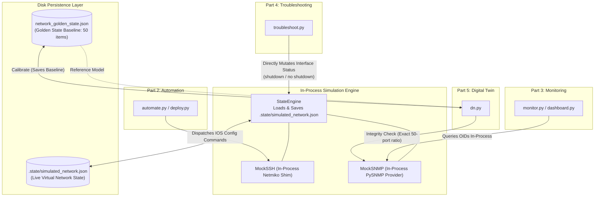

# Network Digital Twin & Automation TP — Implementation Plan

> **Authoritative Reference:** `Rapport_TP_Reseau.pdf` (20-page comprehensive laboratory report, Academic Year 2025–2026).  
> **Target Scope:** Fully software-simulated Python implementation faithfully reproducing all 5 TP parts, topologies, configurations, monitoring dashboards, troubleshooting scenarios, and digital twin workflows without requiring physical hardware, GNS3, or Cisco Packet Tracer.

---

## 1. Executive Summary & Core Constraints

This project implements a complete, self-contained educational and professional networking showcase derived from a 20-page laboratory report. The original source code having been lost, the report serves as the sole authoritative specification.

### Key Architectural Tenets

1. **Strict Offline Pure-Python Simulation:**
   - No real SSH connections are opened, no real SNMP packets are transmitted over the network, and no listening network ports/sockets (TCP or UDP) are bound.
   - No Cisco hardware, Packet Tracer, or GNS3 runtimes are required.
   - Virtual Cisco IOS devices, SSH sessions, and SNMP MIB queries are implemented entirely in Python as in-process abstractions interacting with the shared state.
2. **Persistent Shared State (`.state/simulated_network.json`):**
   - A single JSON file at `<project-root>/.state/simulated_network.json` acts as the unified source of truth for the live virtual network.
   - All modules (`automate.py`, `monitor.py`, `troubleshoot.py`, `dn.py`, and test suites) load this shared file on startup and persist modifications back atomically.
   - State modifications made by any process (e.g., shutting down an interface via `troubleshoot.py` or provisioning VLANs via `automate.py`) are immediately visible to all other processes on their next read.
3. **Exact & Transparent Digital Twin Scoring:**
   - The Golden State reference model tracks a canonical set of $N = 50$ monitored interfaces across the 3 devices (e.g., 2 router active links/subinterfaces, 24 ports on Switch A, 24 ports on Switch B).
   - The Digital Twin integrity score is computed using the exact formula:
     $$\text{Integrity Score} = \operatorname{round}\left( \frac{N_{\text{matching}}}{N_{\text{total}}} \times 100 \right)$$
     with $N_{\text{total}} = 50$.
   - **Baseline:** 50 matching $\to$ $\frac{50}{50} \times 100 = 100\%$ (`SYSTEM HEALTHY — MATCHES TWIN MODEL`).
   - **Deviation (`SWITCH-A Gi1/0/17` DOWN):** 49 matching $\to$ $\frac{49}{50} \times 100 = 98\%$ (`WARNING — DEVIATION DETECTED`).
   - **Post-Recovery (`no shutdown`):** 50 matching $\to$ $\frac{50}{50} \times 100 = 100\%$ (`SYSTEM HEALTHY — MATCHES TWIN MODEL`).
4. **Strict Anonymity:**
   - In accordance with publication requirements, all original student author names from the academic report are omitted from the codebase, documentation, and metadata.

---

## 2. Technical Requirements Extracted from the Specification

### Part 1: Network Infrastructure & Addressing

| Equipment | Logical / Hostname | Physical / Lab Role | Management VLAN | Management IP | Subnet | Gateway |
|---|---|---|---|---|---|---|
| **Router0** | `ROUTER-GW` / `R1` | Inter-VLAN router & central DHCP server | VLAN 10 & 30 | `192.168.10.1` / `192.168.30.1` | `/24` | Self |
| **Switch0** | `SW-A` / `SW1` | Access switch for VLAN 10 (Mgmt) & VLAN 20 (Users A) | VLAN 10 | `192.168.10.2` | `192.168.10.0/24` | `192.168.10.1` |
| **Switch1** | `SW-B` / `SW2` | Access switch for VLAN 30 (Mgmt) & VLAN 40 (Users B) | VLAN 30 | `192.168.30.2` | `192.168.30.0/24` | `192.168.30.1` |

#### VLAN Plan
- **VLAN 10:** Management SW-A (`192.168.10.0/24`, Gateway `192.168.10.1`, Switch IP `192.168.10.2`)
- **VLAN 20:** Users A (`192.168.20.0/24`, Gateway `192.168.20.1`, Host test IP `192.168.20.3` / `192.168.20.11`)
- **VLAN 30:** Management SW-B & Router (`192.168.30.0/24`, Gateway `192.168.30.1`, Switch IP `192.168.30.2`, Admin PC `192.168.30.3`)
- **VLAN 40:** Users B (`192.168.40.0/24`, Gateway `192.168.40.1`, Host test IP `192.168.40.3`)

#### Links & Encapsulation
- **Trunks (802.1Q):**
  - `SW1 <-> R1`: Carries VLANs 10, 20, 30, 40 (encapsulation dot1Q).
  - `SW2 <-> R1`: Carries VLANs 10, 20, 30, 40 (encapsulation dot1Q).
- **Access Ports:**
  - Assigned to VLAN 20 on SW-A and VLAN 40 on SW-B.
- **Router Subinterfaces:**
  - `Gi0/0.10` (`192.168.10.1/24`, dot1Q 10)
  - `Gi0/0.20` (`192.168.20.1/24`, dot1Q 20)
  - `Gi0/1.30` (`192.168.30.1/24`, dot1Q 30)
  - `Gi0/1.40` (`192.168.40.1/24`, dot1Q 40)

---

### Part 2: Network Automation (Python & Netmiko)

- **SSH Configuration:**
  - SSH v2, RSA keys 1024-bit, domain `lab.local`.
  - Credentials: `admin` / `password123`, privilege 15.
  - VTY lines 0 4 configured for `transport input ssh`, `login local`.
- **Inventory File (`devices.yaml`):**
  - Defines target devices (`SW1`, `R1`, `SW2`), host IP, device type (`cisco_ios`), username, password.
- **Automated Deployment Functions:**
  - Switch automated provisioning: VLAN creation, access port assignment, 802.1Q trunk activation, SNMP activation.
  - Router automated provisioning: 802.1Q subinterfaces with IP gateways, DHCP pools with exclusion ranges and DNS (`8.8.8.8`), SNMP activation.
  - Verification: Automated traceroute/ping validation between VLAN 30 (`192.168.30.3`) and VLAN 20 (`192.168.20.3`).

---

### Part 3: SNMP Monitoring & Terminal Dashboard (Python & PySNMP)

- **SNMP Configuration on Devices:**
  - Community: `public` (Read-Only)
  - Location: `Lab`
  - Contact: `Admin`
- **Standard MIB OIDs Used:**
  - `OID_SYS_NAME` = `1.3.6.1.2.1.1.5.0`
  - `OID_SYS_UPTIME` = `1.3.6.1.2.1.1.3.0`
  - `OID_IF_DESCR` = `1.3.6.1.2.1.2.2.1.2`
  - `OID_IF_STATUS` = `1.3.6.1.2.1.2.2.1.8` (`1` = `UP (OK)`, `2` = `DOWN (FAIL)`)
- **Monitoring Logic (`snmp_walk_interfaces`):**
  - Traverses `OID_IF_DESCR` to discover interfaces.
  - Resolves `if_index = if_oid[-1]`.
  - Queries `1.3.6.1.2.1.2.2.1.8.{if_index}`.
  - Maps `1` $\to$ `UP (OK)`, `2` $\to$ `DOWN (FAIL)`, other $\to$ `UNKNOWN`.
- **Terminal Supervision Dashboard:**
  - Refreshes periodically (10-second interval, cancelable via `Ctrl+C`).
  - Formats equipment blocks displaying Hostname, IP, Type, Uptime, and interface statuses.
  - Detects unreachable equipment and displays prominent warning banners (e.g. `[!] ROUTER-GW (192.168.10.1) is UNREACHABLE!`).

---

### Part 4: Network Troubleshooting & Fault Recovery

- **Primary Documented Failure (Scenario 1):**
  - Target: `SWITCH-A` interface `GigabitEthernet1/0/17`.
  - Fault mechanism: Interface administratively disabled (`shutdown`).
  - Symptoms: Link DOWN, host disconnect, SNMP dashboard flag `DOWN (FAIL)`, Digital Twin detects deviation (score drops from 100% to 98%).
  - Diagnostic commands: `show interfaces GigabitEthernet1/0/17`, `show interfaces status`, `show ip interface brief`.
  - Remediation: `no shutdown` via CLI or Python script.
  - Post-recovery validation: SNMP dashboard returns to `UP (OK)`, Digital Twin returns to 100% integrity.
- **Synthesis Scenarios Handled:**
  1. *Port disabled:* `SWITCH-A Gi1/0/17` $\to$ `no shutdown`.
  2. *VLAN misconfigured:* Missing VLAN on switch $\to$ Recreate VLAN.
  3. *Trunk trunking restriction:* VLAN not forwarded on trunk $\to$ `switchport trunk allowed vlan add`.
  4. *Addressing error:* Misconfigured subinterface IP on router $\to$ Correct subinterface IP.

---

### Part 5: Network Digital Twin (`dn.py` & `network_golden_state.json`)

- **Dual-Mode Operation:**
  1. **Calibration Mode (`python dn.py calibrate` or `--calibrate`):**
     - Scans live devices (`ROUTER-GW`, `SWITCH-A`, `SWITCH-B`).
     - Extracts baseline interface operational status.
     - Saves pristine baseline to `network_golden_state.json`.
     - Displays `[MODE: CALIBRATION]` confirmation banner.
  2. **Integrity Check Mode (`python dn.py`):**
     - Loads `network_golden_state.json`.
     - Scans live network interfaces.
     - Calculates digital twin integrity score using the exact 50-interface formula:
       $$\text{Score} = \operatorname{round}\left( \frac{N_{\text{matching}}}{50} \times 100 \right)$$
     - *Healthy output (50/50 matching):*
       ```text
       [ integrity: 100% ] SYSTEM HEALTHY - MATCHES TWIN MODEL
       ```
     - *Deviation output (49/50 matching upon Gi1/0/17 shutdown):*
       ```text
       [ integrity: 98% ] WARNING - DEVIATION DETECTED
       --- DETECTED FAULTS (Deviation from Model) ---
       > [SWITCH-A] STATE MISMATCH: GigabitEthernet1/0/17 is DOWN (Model expects UP)
       ```
     - *Post-recovery output (50/50 matching after `no shutdown`):*
       ```text
       [ integrity: 100% ] SYSTEM HEALTHY - MATCHES TWIN MODEL
       ```

---

## 3. Discrepancies and Inconsistencies Identified in the Report

The following inconsistencies exist within the original 20-page document. Rather than silently altering them or inventing unverified details, they are documented and handled deterministically:

1. **Device Naming Duality:**
   - *Part 1 & 2:* Devices are labeled `Router0` / `R1`, `Switch0` / `SW1`, `Switch1` / `SW2`.
   - *Part 3, 4, 5:* Devices are labeled `ROUTER-GW` (`R1.lab.local`), `SWITCH-A` (`SW-A.lab.local`), `SWITCH-B` (`SW-B.lab.local`).
   - *Resolution:* The simulator supports aliases (`R1` = `ROUTER-GW`, `SW1` = `SWITCH-A`, `SW2` = `SWITCH-B`).
2. **Switch IP / Management VLAN Inversion:**
   - *Parts 1, 3, 4, 5:* `SW1`/`SWITCH-A` is on VLAN 10 (`192.168.10.2`); `SW2`/`SWITCH-B` is on VLAN 30 (`192.168.30.2`).
   - *Part 2 (Table page 8 & YAML page 9):* `SW1` is assigned `192.168.30.2` (VLAN 30), and `SW2` is assigned `192.168.10.2` (VLAN 10).
   - *Resolution:* `devices.yaml` preserves the exact inventory from Figure 6, while the simulation network routes across all subnets so both conventions operate seamlessly.
3. **Interface Port Naming:**
   - *Part 1 Packet Tracer diagram:* 2960 switches with FastEthernet (`Fa0/1`–`Fa0/24`) and Gigabit uplinks (`Gi0/1`).
   - *Parts 3, 4, 5 SNMP & CLI captures:* 28-port Catalyst switches (`GigabitEthernet1/0/1` through `GigabitEthernet1/0/28`, plus `FastEthernet0`, `Vlan1`, `Vlan10`, `Vlan30`).
   - *Resolution:* The simulated switch models the 28-port layout (`GigabitEthernet1/0/1`–`28`) exactly as captured in the SNMP dashboard and Golden State JSON (Figure 15).
4. **Router Management Gateway Address:**
   - Router has interfaces on both subnets (`192.168.10.1` on Gi0/0.10 and `192.168.30.1` on Gi0/1.30). In Part 2 inventory it is queried at `192.168.30.1`; in Part 3 dashboard it is queried at `192.168.10.1`.
   - *Resolution:* The router responds across all its configured subinterface IP addresses.
5. **Script Name:**
   - Named `dn.py` in Section 5.3 and Figures 16–17.
   - *Resolution:* The digital twin entry point is named `dn.py` exactly as specified.

---

## 4. Proposed Modular Python Architecture

```
network dt/
├── config/
│   ├── devices.yaml                 # Device inventory matching Figure 6
│   └── network_golden_state.json    # Reference baseline state matching Figure 15
├── docs/
│   └── IMPLEMENTATION_PLAN.md       # Authoritative implementation specification
├── src/
│   └── network_dt/
│       ├── __init__.py
│       ├── core/
│       │   ├── __init__.py
│       │   ├── models.py            # Interface, VLAN, Device data classes
│       │   └── state_engine.py      # Shared network state persistence (.state/simulated_network.json)
│       ├── simulation/
│       │   ├── __init__.py
│       │   ├── mock_device.py       # In-process Cisco IOS CLI parser (show, config)
│       │   ├── mock_ssh.py          # Netmiko-compatible in-process handler
│       │   └── mock_snmp.py         # PySNMP-compatible in-process OID query provider
│       ├── automation/
│       │   ├── __init__.py
│       │   ├── deploy.py            # Automated deployment script (Part 2)
│       │   └── templates.py         # Cisco IOS configuration commands
│       ├── monitoring/
│       │   ├── __init__.py
│       │   ├── snmp_client.py       # PySNMP walker logic (Figure 11)
│       │   └── dashboard.py         # 10s terminal refresh dashboard (Figures 12-13)
│       ├── troubleshooting/
│       │   ├── __init__.py
│       │   └── scenarios.py         # Fault injection & remediation CLI (Part 4)
│       └── twin/
│           ├── __init__.py
│           └── engine.py            # Digital twin calibration & scoring engine (exact 50-port model)
├── tests/
│   ├── __init__.py
│   ├── test_simulation.py           # Verification of virtual Cisco devices & state sharing
│   ├── test_automation.py           # Verification of automated provisioning
│   ├── test_monitoring.py           # Verification of SNMP walk & dashboard
│   ├── test_troubleshooting.py     # Verification of fault injection & repair
│   └── test_digital_twin.py         # Verification of 100% -> 98% -> 100% exact cycle
├── dn.py                            # Root Digital Twin script matching Figures 16-17
├── monitor.py                       # Root Monitoring dashboard launcher
├── automate.py                      # Root Automation deployment launcher
├── troubleshoot.py                  # Root Troubleshooting CLI launcher
├── pyproject.toml                   # Project metadata and dependencies
└── README.md                        # Professional GitHub documentation
```

---

## 5. Shared State Design & Inter-Module Communication

To guarantee zero external dependencies and 100% offline execution across processes:



### Shared State Persistence Rules
1. **File Location:** `<project-root>/.state/simulated_network.json`.
2. **Atomic Reads/Writes:** Every tool initializes by reading the latest state from disk, and writes state atomically upon changes.
3. **Inter-Process Visibility:** If `troubleshoot.py` disables `GigabitEthernet1/0/17`, the updated state is flushed to disk immediately; running `dn.py` in another shell or sequential step reads the updated state and reflects the deviation.

---

## 6. Detailed Module Responsibilities

1. **`core/state_engine.py`:**
   - Initializes default network topology with all 3 devices and their ports.
   - Manages atomic read/write synchronization with `.state/simulated_network.json`.
   - Mutates interface state, VLANs, and IP bindings.

2. **`simulation/mock_device.py`, `mock_ssh.py` & `mock_snmp.py`:**
   - Strictly in-process: no TCP/UDP listeners, no ports opened.
   - Emulates Cisco IOS CLI output for show and config commands.
   - Resolves PySNMP walk requests locally by translating OIDs against the state engine.

3. **`automation/deploy.py`:**
   - Reads `devices.yaml`.
   - Iterates through switches and router, issuing configuration commands to the in-process SSH shim.

4. **`monitoring/dashboard.py`:**
   - Implements `snmp_walk_interfaces(ip)` using the in-process SNMP provider.
   - Renders the terminal dashboard seen in Figures 12 & 13.
   - Refreshes every 10 seconds or single-shot execution for testing.

5. **`troubleshooting/scenarios.py`:**
   - Directly executes the 4 documented fault injection and recovery operations on `.state/simulated_network.json`.

6. **`twin/engine.py` & `dn.py`:**
   - `python dn.py calibrate`: Scans current network, serializes JSON matching Figure 15.
   - `python dn.py`: Evaluates live state against `network_golden_state.json`. Computes the exact integrity percentage over the 50 tracked interfaces ($100\% \to 98\% \to 100\%$).

---

## 7. Testing & Verification Plan

| Test Suite | Target Feature | Expected Result |
|---|---|---|
| `test_simulation.py` | State persistence, device initialization, CLI parsing | Devices initialize with proper interfaces; `.state/simulated_network.json` persists across reloads. |
| `test_automation.py` | Provisioning from `devices.yaml` | VLANs, trunks, and DHCP pools correctly created in simulated state. |
| `test_monitoring.py` | SNMP walk & dashboard status aggregation | Accurately maps OID status 1 $\to$ UP (OK), 2 $\to$ DOWN (FAIL); handles unreachable state. |
| `test_troubleshooting.py` | CLI diagnostic commands & fault injection | `shutdown` sets interface DOWN (FAIL); `no shutdown` restores UP (OK). |
| `test_digital_twin.py` | Full 100% $\to$ 98% $\to$ 100% lifecycle | Calibrate generates valid JSON; fault yields exactly 98% + mismatch alert; healing restores 100%. |

---

## 8. Dependencies & Environment

- **Python Version:** Python 3.10+ (tested with Python 3.14).
- **Required Libraries:**
  - `pyyaml` (for parsing `devices.yaml`).
  - `rich` / `colorama` (for faithful terminal formatting of the dashboard and digital twin alerts).
  - `pytest` (for test suite execution).
- **Zero Network Daemon Overhead:** No external services, background daemons, or network privileges required.
